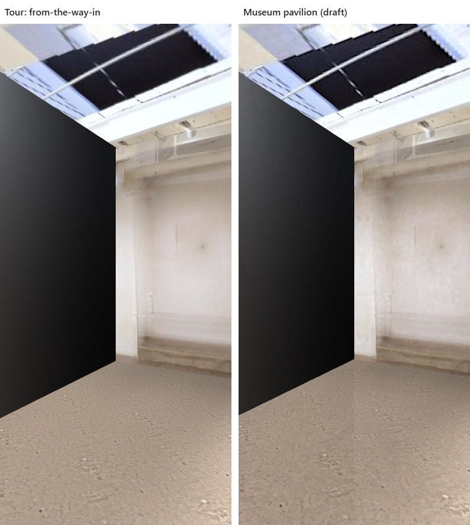
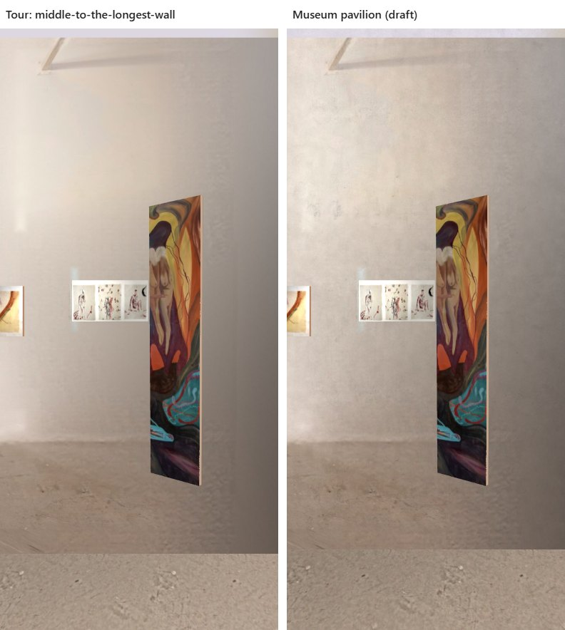
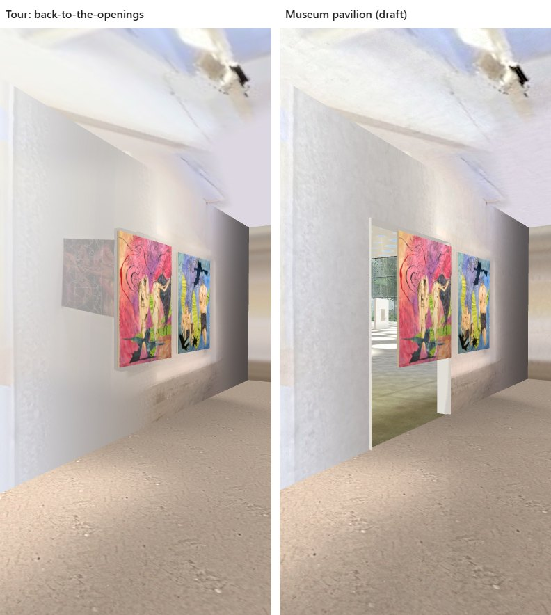

# Draft pavilion: Nature of Man

Made 2026-11-24T13:28 by `space/importer/import.cjs`. **Failed the gate: not offered.**

Plan entry: `{"id":"nature-of-man","type":"house","slot":57,"tour":"nature-of-man","door":[34.5,65.5],"dir":90}`

| | check | result |
|---|---|---|
| ✗ | tour_live | the tour has not passed its own checks (state "not yet"): 8 of 15 works were found in the installation photos; Size missing, or not matching the work's image: Arising, Left Right Center, Three, Q, Emptiness, Man shape; The photos show a different size than recorded: Arising, Emptiness; Only 2 of the room's 4 walls could be measured; The photos don't fit together precisely enough yet; Only 44% of the walls are in the photos; The rebuilt room doesn't match the photos closely enough yet; The rebuilt room doesn't match the photos closely enough yet |
| ✗ | real_openings | the tour has no measured walkable opening (arch or doorway); the importer will not invent one (the pavilion code would cut a 1.9 m door into wall-z0) |
| ✓ | free_place | door at [34.5,65.5] facing 90°, every opening linked (walk from the start 16 m), no space cut off |
| ✗ | jambs | the only way in is invented (no real opening): built, but not real |
| ✓ | text_flush | the wall text is flush on the door wall, in a solid run, clear of the openings |
| ✓ | works | 8 works at their measured size and place |
| ✓ | phone_memory | 419 MB at the start view, 419 MB inside the pavilion (budget 460); the museum without this draft: 350 MB, so the pavilion adds 69 MB at the start |
| ✓ | floor_mirror | the tour's floor is nearly matte (reflect 0.05): the museum floor takes the mirror's tint as it should (gain 4.2, mirror o8-floor) |
| ✓ | px_per_m | at or above the tour: wall-x0 200/200, wall-x1 200/200, wall-z0 200/200, wall-z1 200/200, floor tile 333/333 px/m (4/5 measured on the GPU, the rest from the built pictures), light maps carried |
| ✓ | side_by_side | 3 views saved; every work seen in the tour is seen in the museum, no holes |

## מה חסר כדי שהביתן יעבור (לבעלים)

- מידות של 6 עבודות (רוחב × גובה בס"מ, בשדה המידה של כל עבודה):
  - Arising: שדה המידה ריק, בתיאור כתוב 210×105 ס"מ; הפרופורציה של התמונה רחוקה ב-51% מהמידה, אולי התמונה חתוכה או שהרוחב והגובה התהפכו
  - Left Right Center: שדה המידה ריק, בתיאור כתוב 100×120 ס"מ לכל קנבס (יצירה מכמה קנבסים): צריך את המידה הכוללת כפי שנתלתה, כולל הרווחים, או תמונה של קנבס אחד; הפרופורציה של התמונה רחוקה ב-52% מהמידה, אולי התמונה חתוכה או שהרוחב והגובה התהפכו
  - Three: שדה המידה ריק, בתיאור כתוב 30×40 ס"מ; הפרופורציה של התמונה רחוקה ב-19% מהמידה, אולי התמונה חתוכה או שהרוחב והגובה התהפכו
  - Q: שדה המידה ריק, בתיאור כתוב 35×35 ס"מ; הפרופורציה של התמונה רחוקה ב-14% מהמידה, אולי התמונה חתוכה או שהרוחב והגובה התהפכו
  - Emptiness: שדה המידה ריק, בתיאור כתוב 35×45 ס"מ לכל קנבס (יצירה מכמה קנבסים): צריך את המידה הכוללת כפי שנתלתה, כולל הרווחים, או תמונה של קנבס אחד; הפרופורציה של התמונה רחוקה ב-42% מהמידה, אולי התמונה חתוכה או שהרוחב והגובה התהפכו
  - Man shape: שדה המידה ריק, בתיאור כתוב 37×57 ס"מ; הפרופורציה של התמונה רחוקה ב-13% מהמידה, אולי התמונה חתוכה או שהרוחב והגובה התהפכו
- בצילומים נמדדה מידה אחרת מהרשומה: Arising, Emptiness. לבדוק את המידה או את התמונה.
- 7 עבודות לא נראות באף צילום הצבה: In nature, Left Right Center, Two, Three, Toda, Moroccan pattern, Man shape. צריך צילומים רחבים שבכל אחד 2–3 עבודות ופינת חדר.
- 2 קירות לא נמדדו, רק נוחשו: הקיר הקצר השמאלי (x0), הקיר הקצר הימני (x1). צריך שני צילומים לפחות של כל אחד מהם, מזוויות שונות, כל אחד עם עבודה או פינה בתוכו.
- לא נמדד שום פתח אמיתי (קשת או דלת) שדרכו נכנסים לחדר. צריך צילומים של הכניסה עצמה: מבפנים, מול הפתח ובאלכסון, כשרואים את שני צדי המשקוף ואת הרצפה מתחתיו, ועוד צילום מבחוץ. כך הביתן במוזיאון ייכנס דרך הפתח האמיתי שלו.
- הדרך הבטוחה ביותר במקום כל אלה: סרטון הליכה של דקה–שתיים. טלפון לרוחב, לאט באמצע החדר הלוך וחזור, כל הקירות בתמונה, סיבוב איטי בקצוות עם קצת רצפה ותקרה, ולעבור גם דרך הכניסה.

## Side by side (tour left, museum right)

