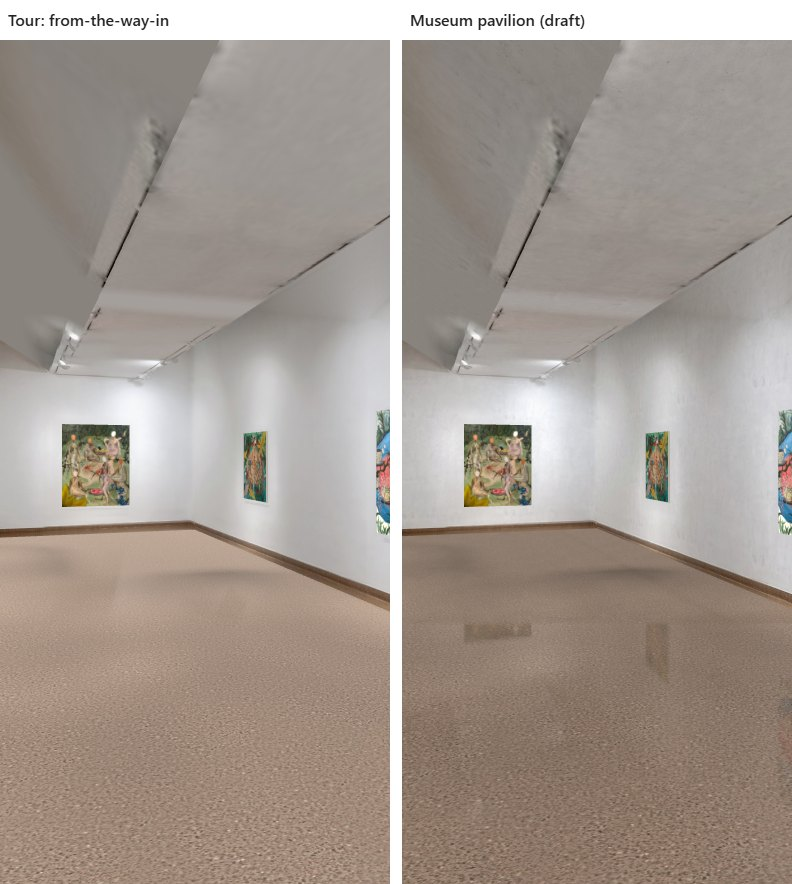
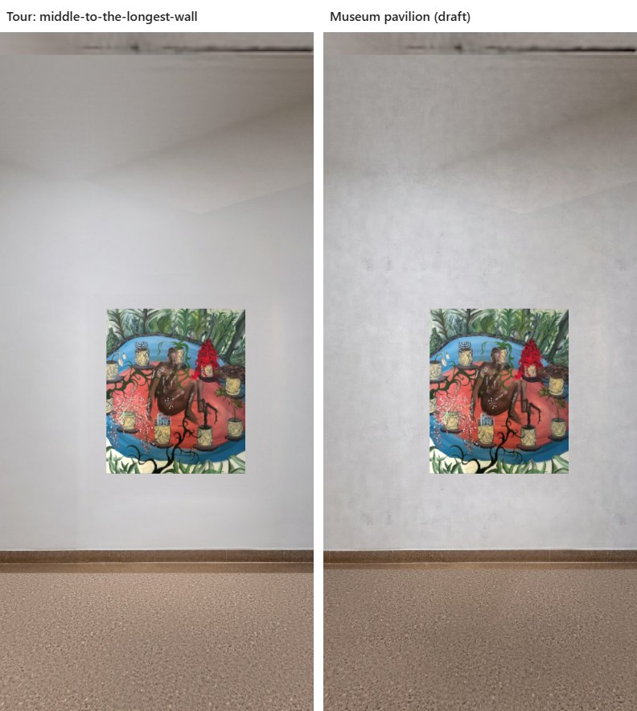
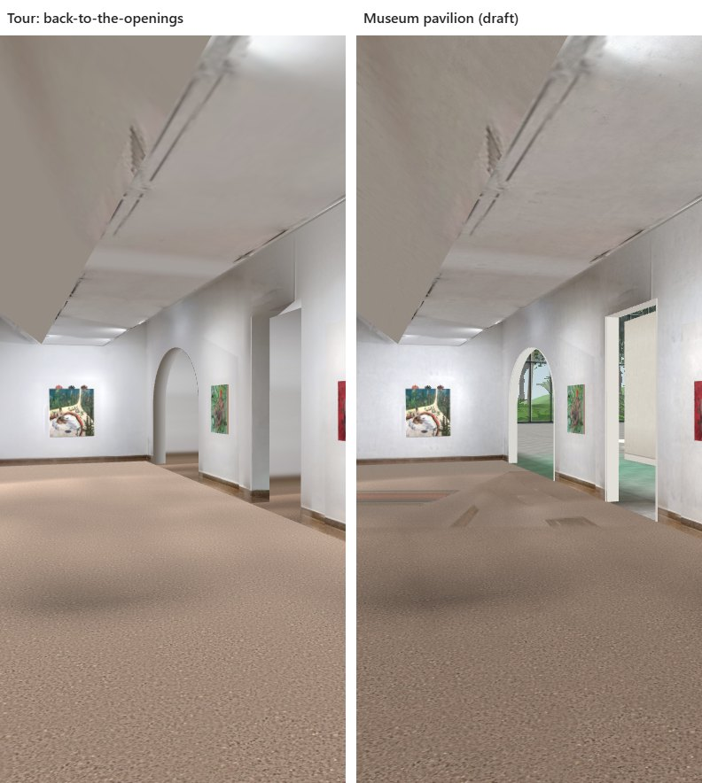

# Draft pavilion: Ritual

Made 2026-11-24T13:25 by `space/importer/import.cjs`. **Passed the gate: waiting for the owner on the Desk.**

Plan entry: `{"id":"ritual","type":"house","slot":57,"tour":"ritual","door":[28,64.5],"dir":90}`

| | check | result |
|---|---|---|
| ✓ | tour_live | the tour passed its own build and inspection |
| ✓ | real_openings | 2 real opening(s) on wall-z1: arch 3.32 x 2.96 m, doorway 1.44 x 3.03 m |
| ✓ | free_place | door at [28,64.5] facing 90°, every opening linked (walk from the start 24 m, 19 m), no space cut off |
| ✓ | jambs | 2 opening(s): full 0.22 m jambs and head, same shape, nothing across the way |
| ✓ | text_flush | the wall text is flush on the door wall, in a solid run, clear of the openings |
| ✓ | works | 10 works at their measured size and place |
| ✓ | phone_memory | 410 MB at the start view, 411 MB inside the pavilion (budget 460); the museum without this draft: 350 MB, so the pavilion adds 60 MB at the start |
| ✓ | floor_mirror | the tour's floor is glossy (reflect 0.293): the museum floor takes the mirror's tint as it should (gain 16.8, mirror o8-floor) |
| ✓ | px_per_m | at or above the tour: wall-x0 200/200, wall-x1 200/200, wall-z0 200/200, wall-z1 200/200, floor tile 333/333 px/m (5/5 measured on the GPU, the rest from the built pictures), light maps carried |
| ✓ | side_by_side | 3 views saved; every work seen in the tour is seen in the museum, no holes |

## Side by side (tour left, museum right)

