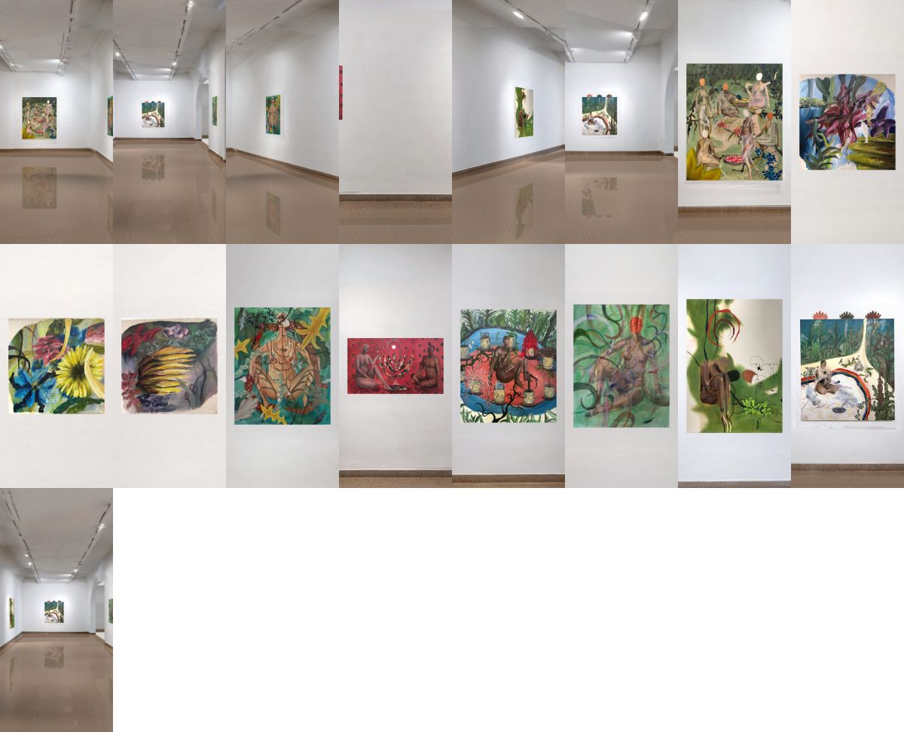

# דוח חלל: Ritual

נבנה אוטומטית ב־2026-10-26 מתוך 6 צילומים ו־15 עבודות (229 שניות).

## מה נמצא

| צילום | עבודות שזוהו |
|---|---|
| `jah-005-1780915457989.jpg` | Ritual, Gathering, Adam, Adam and a Lamp |
| `jah-006-1780915473909.jpg` | Ritual, Adam, Adam and a Lamp, Woman and a gun, Two |
| `jah-007-1780915483464.jpg` | Ritual, Gathering, Woman |
| `jah-008-1780915493251.jpg` | Adam, Adam and a Lamp, Flowers 1, Flowers 3, Flowers 2 |
| `jah-009-1780915500705.jpg` | Ritual, Woman and a gun, Two |
| `jah-010-1780915508773.jpg` | Human nature, Woman and a gun, Two |

## שלב 1: בנייה ובדיקת המדידה

הסיור נבנה מהצילומים ומנתוני העבודות, והמדידה נבדקה מול הצילומים. עבר: ממשיך לבדיקה היסודית (שלב 2).

| | בדיקה | תוצאה |
|---|---|---|
| ✓ | כל העבודות נמצאו | 10 מתוך 10 עבודות נמצאו ומוקמו |
| ✓ | איכות תמונות העבודות | כל התמונות חדות מספיק |
| ✓ | מידה מול תמונה | המידות מתאימות לתמונות |
| ✓ | מידה מול הצילומים | המידות מתאימות למה שנמדד בצילומים |
| ✓ | קירות נמדדו | 4 מתוך 4 קירות נמדדו לפי עבודות |
| ✓ | דיוק המדידה | סטייה ממוצעת 1.8 פיקסלים |
| ✓ | כיסוי הקירות בצילומים | 84% מהקירות נראו היטב בצילומים |
| ✓ | כל עבודה תואמת לצילום | כל העבודות, כפי שהן מוצגות, תואמות לצילומים |
| ✓ | הקיר סביב העבודות | הקיר סביב כל עבודה תואם לצילומים |
| ✓ | הקירות תואמים לצילומים | הקירות תואמים לצילומים (הפרש 1.8) |

מה יעזור: תמונה איכותית (2000 פיקסלים ומעלה, לא חתוכה) ומידה נכונה לכל עבודה; צילומי הצבה רחבים שבכל אחד 2–3 עבודות ופינת חדר, כך שכל קיר וכל עבודה מופיעים בשני צילומים לפחות; או סרטון הליכה איטי של דקה–שתיים.

## שלב 2: בדיקה יסודית בתוך הסיור

הסיור נפתח באפליקציה עצמה, על מסך בגודל טלפון, וצולם מ־139 נקודות מבט: מכל צילום, מנקודת ההתחלה, מרשת של מקומות לאורך החדר לכל הכיוונים, וכל עבודה מלפנים, מקרוב ומהצדדים (65 שניות).

**עבר: הסיור מתפרסם.**

| | בדיקה | תוצאה |
|---|---|---|
| ✓ | נפתח בלי שגיאות | נפתח בלי שגיאות וכל הקבצים נטענים |
| ✓ | עבודות על הקיר | כל עבודה תלויה על קיר (לא בתוכו ולא באוויר) |
| ✓ | עבודות בתוך החדר | כל העבודות בין הרצפה לתקרה |
| ✓ | בלי חפיפות | אין עבודות זו על זו |
| ✓ | בלי חורים | אין חורים בחלל מאף נקודת מבט |
| ✓ | עבודות שלמות | כל עבודה מוצגת שלמה |
| ✓ | עבודות חדות | כל עבודה חדה כמו התמונה שלה |
| ✓ | חדות מקרוב | גם מקרוב העבודות שומרות על הפרטים |
| ✓ | צבעים נכונים | כל עבודה בצבעים שלה, בלי גוון זר |
| ✓ | קירות נקיים | הקירות נקיים: אין שאריות של עבודות או כתמים |
| ✓ | בלי כתמים | אין כתמים כהים על הקירות |
| ✓ | בלי מריחות | אין מריחות בקירות |
| ✓ | בלי תפרים | אין תפרים על הקירות (מעבר חד בין צילום לצילום) |
| ✓ | צורת החדר מול הצילומים | צורת החדר תואמת לצילומים (כל צילום נבדק מול האחרים: 0.65) |
| ✓ | רצפה בלי פסים | מרקם הרצפה אחיד, בלי פסים |

## מידות

- **החדר:** 14.02 × 4.13 מ', גובה 4.16 מ'.
- **רצפה:** נמדדה: הקו שבו הקירות פוגשים את הרצפה בכל הצילומים.
- **תקרה:** נמדדה: אמצע שטוח (הקווים שלאורך החדר) ושיפועים עד ראש הקירות.
- **דיוק המדידה:** סטייה ממוצעת של 1.8 פיקסלים בין המודל לצילומים.

| קיר | איך נקבע |
|---|---|
| x0 | נמדד לפי Gathering |
| x1 | נמדד לפי Woman and a gun |
| z0 | נמדד לפי Ritual, Two, Woman |
| z1 | נמדד לפי Flowers 3, Flowers 2, Adam, Adam and a Lamp, Human nature, Flowers 1 |

## עבודות

| עבודה | מידה רשומה (ס"מ) | נמדד בצילומים (ס"מ) | גובה המרכז מהרצפה | הערה |
|---|---|---|---|---|
| Adam, Adam and a Lamp | 120 × 70 | 120 × 70 | 1.53 מ' |  |
| Flowers 1 | 30 × 30 | 30 × 30 | 1.65 מ' |  |
| Flowers 2 | 30 × 30 | 30 × 30 | 1.65 מ' |  |
| Flowers 3 | 30 × 30 | 30 × 30 | 1.65 מ' |  |
| Gathering | 140 × 170 | 140 × 170 | 1.43 מ' |  |
| Human nature | 70 × 90 | 69 × 89 | 1.52 מ' |  |
| Ritual | 110 × 130 | 109 × 130 | 1.45 מ' |  |
| Two | 100 × 140 | 100 × 139 | 1.40 מ' |  |
| Woman | 90 × 110 | 90 × 110 | 1.46 מ' |  |
| Woman and a gun | 122 × 143 | 122 × 143 | 1.45 מ' |  |

> **בנייה חדשה לא עברה את הבדיקה** (חור בחלל (start-3); תפר על קיר (grid-2-1-4); צורת החדר לא תואמת לצילומים (0.56; הכי פחות: photo-3, 0.30)). הגרסה שעברה את כל הבדיקות נשארת באוויר, בלי שינוי.
